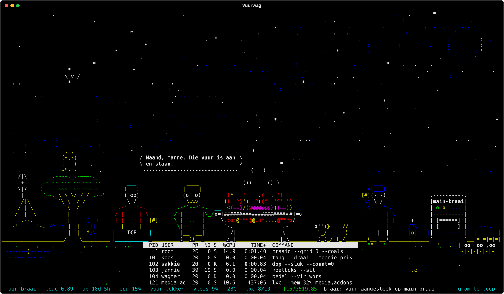

# Vuurwag — die HugeBraai vuurwag



```
# on your Proxmox node, as root
curl -fsSL https://raw.githubusercontent.com/RuanBuitendag42/vuurwag/main/install.sh | bash -s -- --tv
# monitor plugged into the node as well:
curl -fsSL https://raw.githubusercontent.com/RuanBuitendag42/vuurwag/main/install.sh | bash -s -- --tv --monitor --place "Your Town, South Africa"
```

A braai in ASCII art for your Proxmox VE node: three okes and a brakkie around a half-drum braai under the Southern
Cross, on a plaas. The fire burns with the node's CPU, the LXCs are on the grid and in a `top(1)` table, guests
starting and stopping, backups, disks and the firewall turn into `wall(1)` broadcasts and Koos's comments, and the
real weather (Open-Meteo, no key) sets the sky. Show it on a TV in a browser, on the monitor plugged into the node, or
in any terminal. The only interaction is a keyboard full of easter eggs (`?` lists them).

It is a port of **`lekker`**, a Perl braai by a friend, into Python/Textual, rewritten in farm Afrikaans.

Want to read the script before you pipe it into a root shell? Do:
`curl -fsSLO https://raw.githubusercontent.com/RuanBuitendag42/vuurwag/main/install.sh && less install.sh && bash install.sh --tv`.

## What the installer does

Run as root on a Proxmox VE 8 or 9 node (Python 3.11 / 3.13 are already there). Rerunning it upgrades in place.

| Flag | Effect |
|---|---|
| *(none)* | install the files and the venv, enable nothing, print the next steps |
| `--tv` | enable `vuurwag-web` (the page for the TV) and allow `--lan` to its port in pve-firewall |
| `--monitor` | enable `vuurwag-kiosk` (cage + foot on tty1), only after a preflight passes |
| `--place "Town, Country"` | town for the weather |
| `--port N` | web port (default 8787) |
| `--lan CIDR` | LAN allowed to the port (default: the network of the node's primary interface, printed) |
| `--public-url URL` | the URL the TV uses (default `http://<node ip>:<port>`; set it for a DNS name or Tailscale) |
| `--fps N` | frames a second, 1-20 (default 10) |
| `--ref REF` | git branch or tag to install (default `main`) |
| `--check` | preflight and status only; changes nothing |
| `--uninstall` | remove it (asks before removing the `vuurwag` user and `/etc/vuurwag`; `--yes` skips the questions) |

What lands where:

- `apt-get install --no-install-recommends python3-venv smartmontools lm-sensors curl iproute2` (plus
  `cage foot seatd fonts-dejavu` with `--monitor`). The probe calls `pvesh`, `pct`, `pvesm`, `pve-firewall`,
  `pveversion`, `lsblk`, `smartctl`, `zpool`, `sensors` and `tailscale`; the last three are optional.
- `/opt/vuurwag/src` — the source tarball of `--ref` from GitHub (swapped in whole on every run).
- `/opt/vuurwag/.venv` — a plain `python3 -m venv`; dependencies installed from `requirements.txt`, which is
  exported from `uv.lock` with exact versions and hashes. No uv on the node.
- `/etc/vuurwag/vuurwag.env` — the config (below). Written once; a rerun only changes the keys you pass as flags.
- `/etc/systemd/system/vuurwag-web.service` and `vuurwag-kiosk.service` — always staged, enabled only by `--tv` /
  `--monitor`.
- With `--tv`, if pve-firewall is enabled: one line under `[RULES]` in `/etc/pve/nodes/<node>/host.fw`:
  `IN ACCEPT -source <lan> -p tcp -dport <port> -log nolog # vuurwag-web`. If the firewall is off, the rule is
  printed instead.
- With `--monitor`: a user `vuurwag` (groups video, input, render), its ed25519 key, one restricted line in root's
  `authorized_keys`, `127.0.0.1` in its `known_hosts`, and `~vuurwag/.config/foot/foot.ini` (only if absent).

## The config file

`/etc/vuurwag/vuurwag.env` (see `deploy/vuurwag.env.example`):

```
VUURWAG_PLACE="Pierre van Ryneveld, Centurion, South Africa"   # the default; change it to your town
VUURWAG_PORT="8787"
VUURWAG_LAN="192.0.2.0/24"
VUURWAG_PUBLIC_URL="http://192.0.2.10:8787"
VUURWAG_FPS="10"
```

Edit it and `systemctl restart vuurwag-web vuurwag-kiosk`, or rerun the installer with the flag. The place is
geocoded most-specific-part first and falls back part by part, so "Suburb, Town, Country" works.

## On the TV

Open `http://<node ip>:8787` in the TV's browser (the installer prints the exact URL). textual-serve runs the app on
the node and draws it with xterm.js in the browser; one app process per open tab.

- Android / Google TV: a kiosk browser app such as **Fully Kiosk Browser** pointed at the URL survives TV restarts
  and sleeps better than the built-in browser.
- Smart-TV browsers are slow at xterm.js. If frames stutter, rerun with `--fps 4` (or set `VUURWAG_FPS="4"`).
- Reaching it by a name or over Tailscale: rerun with `--public-url http://name:8787`. The page's websocket URL is
  built from it; a wrong one gives a page that loads and then stays black.

## On the monitor plugged into the node

`--monitor` runs `cage -- foot -e vuurwag --ssh root@127.0.0.1` on tty1 as the unprivileged user `vuurwag`.

- **Font size**: `~vuurwag/.config/foot/foot.ini`, `font=DejaVu Sans Mono:size=11`. Aim for about 160x45 cells:
  1080p -> 11, 1440p -> 14 or 15, 4K -> about 22. Too few columns hides scenery. Use a font without programming
  ligatures (the art types `->`, `==<` and `|=|` literally). `systemctl restart vuurwag-kiosk` after an edit.
- **Palette**: foot's default looks washed out; `deploy/foot.ini` carries a vivid 8-colour `[colors]` block.
- **tty1 safety**: the kiosk is enabled only after the preflight (user exists; cage, foot and seatd installed; seatd
  active; `vuurwag` can `ssh -o BatchMode=yes root@127.0.0.1`). If it does not stay up for 5 s the installer rolls it
  back; if it dies later, `OnFailure=` starts `getty@tty1` again. `getty@tty1` stays enabled throughout.
- **Plain console instead of Wayland**: `deploy/getty-autologin.conf` is a drop-in for `getty@tty1` that autologs
  the `vuurwag` user, whose `~/.profile` sets a big console font and execs vuurwag. The VT has the 8 colours the art is
  drawn in. Instructions are in the file; disable `vuurwag-kiosk` first.

## Updating

Rerun the same command. It downloads `--ref` again, reinstalls the venv's packages, keeps your config and foot.ini,
and restarts whatever was running.

## Uninstalling

```
curl -fsSL https://raw.githubusercontent.com/RuanBuitendag42/vuurwag/main/install.sh | bash -s -- --uninstall
```

Stops and disables both units, removes them, `/opt/vuurwag`, the `authorized_keys` line and the firewall rule,
re-enables `getty@tty1`, then asks before removing the `vuurwag` user and `/etc/vuurwag` (`--yes` answers yes).

## Security

- **textual-serve has no authentication.** Anyone who can reach the port sees the node's guests, disks and load.
  Keep it on the LAN or Tailscale; the installer's firewall rule only admits `--lan`. Never port-forward it.
- **The probe is read-only**: `pvesh get`, `pct list`, `pvesm status`, `smartctl -a` (it never starts a self-test),
  `pve-firewall status`, `zpool list/status`, `sensors`, `tailscale status`. It is `vuurwag/probe/probe.py`,
  standard library only; read it.
- The web service runs as root because those commands need root, and probes locally.
- The monitor runs as the unprivileged `vuurwag` user. Its key is pinned in root's `authorized_keys` to
  `from="127.0.0.1,::1",command="python3 -",restrict`: it can only feed a Python program to the node from the node
  itself, with no shell, pty or forwarding. That still means "root runs what the vuurwag user sends": treat the
  `vuurwag` account as sensitive. On Proxmox `/root/.ssh/authorized_keys` points into `/etc/pve/priv`, which is
  shared across a cluster; the line is usable only from a node's own localhost, by whoever holds the private key.

## Troubleshooting

| Symptom | Cause | Fix |
|---|---|---|
| Monitor black, no login prompt on tty1; `systemctl status vuurwag-kiosk` shows `status=217/USER` | The kiosk unit was enabled before the `vuurwag` user, cage, foot and seatd existed; its `Conflicts=getty@tty1` had stopped the login prompt | `systemctl disable --now vuurwag-kiosk; systemctl enable --now getty@tty1`, then rerun with `--monitor`. The installer now refuses to enable it until the preflight passes, and `OnFailure=` brings getty back |
| `vuurwag-web` in a restart loop; journal says it cannot write `/root/.cache` | An old unit ran `uv run` under `ProtectHome=read-only` | Rerun the installer: the unit now runs `/opt/vuurwag/.venv/bin/vuurwag` directly; uv is not used on the node |
| TV page loads but the network is dead and there are no LXCs | An old unit told the root web service to probe over `--ssh root@127.0.0.1`, and root had no key for itself | Rerun the installer: the web unit probes locally (no `--ssh`). `systemctl cat vuurwag-web` must show no `--ssh` |
| Monitor shows only part of the scene (no tree, tower or bakkie) | The font in foot.ini was not installed; foot fell back to a wide font, too few columns | `apt install fonts-dejavu`, `font=DejaVu Sans Mono:size=11` for 1080p (`fc-list \| grep "DejaVu Sans Mono"` to check) |
| Colours on the monitor look washed out | foot's default palette | Use the `[colors]` block from `deploy/foot.ini` (an existing foot.ini is never overwritten) |
| TV cannot reach the page (times out) but `curl -I http://127.0.0.1:8787` on the node works | pve-firewall's ingress policy is DROP | `--check` shows the rule; `--tv` adds it when the firewall is enabled. By hand, under `[RULES]` in `/etc/pve/nodes/<node>/host.fw`: `IN ACCEPT -source <lan> -p tcp -dport 8787 -log nolog` |
| TV page loads, then stays black / "connecting" | `VUURWAG_PUBLIC_URL` is not an address the TV can reach (the websocket is built from it) | Rerun with `--public-url http://<address the TV uses>:8787` |
| *"probe: geen antwoord"* in the log and a low fire | The probe failed (ssh down, node rebooting) | It retries every interval; `journalctl -u vuurwag-kiosk` |
| Dokter Disk sees no disks | `smartctl` needs root | Run the probe as root (`--ssh root@...`, or the web unit) |
| The boot log says "geen internet" | No Open-Meteo | The sky follows the clock; nothing else changes |
| The screen says "maak die venster groter" | Under 60x18 there is no room for a braai | Smaller font, bigger window |

`--check` prints all of it in one go: packages, venv, config, units, getty, firewall, the web port and the monitor
preflight.

## Running it from a workstation

Everything goes through [uv](https://docs.astral.sh/uv/) here. Python >= 3.11.

```bash
git clone https://github.com/RuanBuitendag42/vuurwag && cd vuurwag
uv sync
uv run vuurwag --demo                            # fake but lively data and cycling weather, works anywhere
uv run vuurwag --ssh root@pve.example.lan        # real data from your node over ssh, real weather
uv run vuurwag --ssh root@pve.example.lan --once # one probe, a human summary, exit (--json for the Snapshot)
uv run vuurwag serve -- --demo                   # the browser version on http://localhost:8787
uv run pytest                                    # the tests
```

The probe is streamed to the node over ssh as `python3 -` once per tick and needs root there; `--ssh you@node --sudo`
works if passwordless sudo is set up. Flags: `--fps N`, `-g`/`--green` (phosphor), `--truecolor`, `--no-disks`,
`--place "Town, Country"` (or `$VUURWAG_PLACE`), `--weather COND`, `--no-weather`, `--time HH:MM`,
`--date MM-DD[ HH:MM[:SS]]` (the special days), `--debug`, `--seed N`, `--host NAME`, `--interval N`,
`--screenshot out.svg --size 160x45 --wait 6 --keys t,o`. At 160x45 and 10 fps a frame costs about 1 ms and under
10 % of a core.

## What is in it

- **From lekker, 1:1**: the art (Koos, Sakkie, Jannie, Wagter the brakkie, the half-drum braai, the moon, the
  Southern Cross, thorn trees, the tower, the bakkie, Tannie Sarie, Oom Faan, Dokter Disk), the layout rules per
  screen size, the fire, smoke, meat and banter mechanics, `wall(1)`, the `top(1)` table, the boot log, and the
  extras: weather and time of day, the party (vuurwerk, sokkie, songs, rugby, the special days), the kuier
  (Tannie, Oom, Eskom, hout, more meat, the town) and Dokter Disk. Pure 7-bit ASCII in the 8 ANSI colours.
- **Added**: the node in lekker's idiom (CPU drives the fire, LXCs on the grid and in `top`, node events as walls and
  dmesg lines; Dokter Disk only reads SMART), Open-Meteo driving the weather (plus a sixth state, mis), the plaas
  (windpomp, dam, kraal, critters, new skits), more South African special days, and the whole voice in farm
  Afrikaans first, SA English second.

The full inventory and the design notes are in [DESIGN.md](DESIGN.md).

### Keys (`?` in the app shows the same)

| Key | Effect | Key | Effect |
|---|---|---|---|
| `q` | loop / leave | `space` | volgende lyn gesels |
| `f` | blaas die vuur aan | `d` | gooi 'n dop oor |
| `b` | Wagter kry idees | `g` | groen fosfor |
| `w` | die weer | `n` | tyd van die dag |
| `v` | vuurwerk | `k` | sokkie |
| `s` | sing | `r` | rugby oor die radio |
| `t` | Tannie Sarie bring kos | `o` | Oom Faan kom kuier |
| `l` | beurtkrag | `h` | hout op die vuur |
| `m` | meer vleis | `x` | Dokter Disk (lees net) |
| `j` | 'n grap | `1`-`4` | the tricks |
| `a` | die dominee | `i` | 'n selfie |
| `u` | Jannie gaan haal hout | `p` | iemand pook Koos se vuur |
| `z` | gas teen hout | `e` | 'n dier |
| `5` `6` | Wagter steel 'n dop; 'n koue een vir Oom | `P`, Konami | the letters of fire |

## Credits

The art, the mechanics and the spirit are **lekker**'s, the Perl braai by a friend of the author; Vuurwag is a
faithful port with a plaas on top. It was first lit on the HugeBraai node main-braai. The weather is from
[Open-Meteo](https://open-meteo.com/); the TV page is [textual-serve](https://github.com/Textualize/textual-serve).

## Licence

MIT — see [LICENSE](LICENSE).
